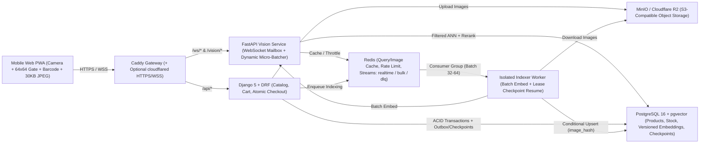

> **Language:** **English** | [繁體中文](./SYSTEM_DESIGN.zh-TW.md)

# Visual Product Search & High-Concurrency Commerce — System Design

This document captures the architecture, back-of-the-envelope capacity estimates, mobile edge–cloud compute partitioning, dataflows, and failure-mode mitigations for rebuilding `DeepImageSearch_with_django` into an **AI Inference Infrastructure & High-Concurrency Visual Shopping** platform.

---

## 1. AI Inference System Design Framework (1-to-1 Parallel with LLM Serving)

| AI Infra Pillar | LLM Inference Serving | Visual Product Search Inference (This Project) |
| :--- | :--- | :--- |
| **High-Level Topology** | Client → Router → GPU Prefill/Decode → KV Store | Mobile Edge Gate → ASGI Gateway → **Online GPU Encoding Pool** → **Two-Stage Vector Retrieval** → Django Commerce Core |
| **Memory & Compute Optimization** | KV Cache + GQA | Multi-tier Feature Cache (Edge `track_id` + Redis Image Hash / `search_id`) + **Matryoshka (MRL) & Binary/Halfvec Quantization** (shrinks 10M vectors from ~30 GB to ~1 GB RAM) |
| **Batching** | Continuous Batching | **SLA-Aware Dynamic Micro-Batching** (`max_wait=15ms`, `max_batch=16`) with fixed `384x384` inputs (no ragged-token padding waste) + deadline drop |
| **Stage Disaggregation** | Prefill–Decode (PD) Separation | **Compute-bound GPU Encoding Pool** vs **Memory-bound Vector ANN Pool** vs **IO-bound Commerce Pool**, plus **Online Latency Pool** vs **Offline Bulk-Indexing Pool** |
| **Parallelism & Scaling** | Tensor Parallelism (TP) + Pipeline Parallelism (PP) | Vision encoders (SigLIP/OpenCLIP, 100M–400M params, `<1.5 GB` FP16) fit on 1 GPU → **Pure Data Parallelism (DP) + Multi-Stream/MIG** (no TP AllReduce overhead) + Vector Index Sharding |

---

## 2. Back-of-the-Envelope Estimation (10M SKUs / 5M DAU Target)

- **Assumptions:** `10,000,000` product images; `5,000,000` DAU; `10%` scan daily (`500,000` daily scanners × `10` keyframe queries/session = `5,000,000` queries/day).
- **QPS:**
  - Average: `5,000,000 / 86,400 ≈ 58 QPS`
  - Peak (5x diurnal × 3x flash sale): **`~900 Peak QPS`**
- **Ingress Bandwidth (Why Mobile Edge Gating Matters):**
  - Uncompressed 5 FPS streaming (`3 MB × 5 = 15 MB/s` per phone): impossible on 4G.
  - Mobile `64×64` stability/blur gate + `384px` JPEG (`~30 KB`) at `~1 FPS` steady: `900 × 30 KB ≈ 27 MB/s (~216 Mbps)` total peak ingress.
- **Vector Index Memory (`10M` images × `768`-dim):**
  - Raw `FP32`: `10M × 768 × 4 bytes = 30.7 GB` (+ HNSW graph ≈ `35–40 GB RAM`).
  - Two-stage **Binary Quantization (`768-bit = 96 bytes`) coarse RAM + NVMe `FP16` rerank**:
    - Coarse index in RAM: `10M × 96 bytes ≈ 0.96 GB` (**32x RAM reduction**).
    - Rerank Top-100 with `FP16` vectors (`15.4 GB` on NVMe, `<2 ms` random read).
- **GPU Throughput & Batching (NVIDIA L4 / A10G running SigLIP-Base FP16):**
  - `batch=1`: `~7 ms` → max `~140 QPS/GPU` (~20% compute utilization).
  - Dynamic `batch=16` (`max_wait=15 ms`): `~28 ms` forward pass → **`~570 QPS/GPU`** (**4x throughput**, total latency `15 + 28 = 43 ms`).
  - Capacity for `900 Peak QPS` with 2x headroom (`1,800 QPS`): **3–4 L4 GPUs** via pure Data Parallelism.

---

## 3. Mobile Edge–Cloud Compute Partitioning

Because mobile browsers (especially iOS Safari) suffer battery drain, thermal throttling, and WASM memory limits under heavy client ML, computation is partitioned by **compute-to-bandwidth ratio** with a **3-tier adaptive profile**:

| Stage | Location | Rationale |
| :--- | :--- | :--- |
| Resize & JPEG Compress (`384–512px`) | **Phone (Always)** | `<3 ms`; cuts upload 150x (`5 MB → 30 KB`) and removes server decode bottleneck. |
| Blur, Motion & Scene-Change Gate (`64×64` canvas) | **Phone (Always)** | `<2 ms`, zero ML download; eliminates **80–90%** of wasted server frames. |
| Barcode / QR Decode | **Phone (Always)** | Native `BarcodeDetector` (Android) / lightweight WASM (iOS); skips ML (`0` GPU ms) for exact packaged SKUs. |
| Object Detection & Box Tracking | **Adaptive (Tier 2)** | Skipped on first visit/low-end phones (Tier 0/1); cached ~3 MB detector for returning PWA users on WebGPU-capable phones (Tier 2). |
| Product Embedding (SigLIP / OpenCLIP) | **Server (Always)** | 150–400 MB weights; dynamic micro-batching on server GPU is cheaper and silently upgradeable. |
| Vector ANN Search + Live Stock (`pgvector`) | **Server (Always)** | Requires live catalog, pricing, and inventory state. |
| Track Cache & UI Hysteresis | **Phone (Always)** | Prevents flicker and duplicate lookups for already-identified items. |

### Closed-Loop Server-to-Edge Throttling
Every WebSocket response includes a control hint (`throttle: { min_interval_ms, max_dim, mode }`):
- **Normal load (<50%):** `min_interval_ms: 500`, `mode: "auto_keyframe"`.
- **High load (70–90%):** `min_interval_ms: 1500–2500`, `max_dim: 320` (smoothly cuts QPS 3–5x at the edge).
- **Overload (>90%):** `mode: "manual_tap"` (pauses auto-streaming; manual shutter & barcode remain responsive with zero queue death spiral).

---

## 4. End-to-End Architecture & Dataflows

---

## 5. Key Queue, Concurrency & Streaming Problems Handled

1. **Streaming vs. Durable Queue Semantics (Why Live Camera Search Never Uses a FIFO MQ):**
   - Live camera streams use a **Size-1 Latest-Frame-Wins Mailbox** per session (drop stale frames, never retry, monotonic `seq_id` guard against out-of-order responses).
   - Catalog indexing & async jobs use **Redis Streams** (Consumer Groups, `XACK`, `XAUTOCLAIM`, DLQ) behind a pluggable `EventBroker` interface (cleanly swappable to RocketMQ/Kafka at 100x scale).
2. **Head-of-Line Blocking Isolation:** Separate `stream:index:realtime` vs `stream:index:bulk` channels and bounded online/offline inference quotas ensure a 10,000-SKU bulk import never degrades live shopper P99 latency.
3. **Mid-Batch Crash Recovery & Resumable Checkpoints:** `BatchJob` + per-image `index_status` (`PENDING` / `PROCESSING` / `INDEXED` / `FAILED`) + `lease_until` timeout lets another worker automatically reclaim only the interrupted chunk on crash—zero lost progress, zero duplicate work.
4. **Out-of-Order Image Update Guard:** Immutable S3 keys + conditional DB upsert (`WHERE image_hash = :expected_hash`) ensures an older slow worker never overwrites a newer product image embedding.
5. **Poison Pills & Decompression Bombs:** Gateway upload size cap + `Image.MAX_IMAGE_PIXELS` + strict separation of retryable (timeout/503 → exponential backoff) vs non-retryable (`UnidentifiedImageError` → immediate `FAILED` + DLQ).
6. **Vector + SQL Pre-Filtering ("Empty Results" Trap):** `pgvector` 0.8+ HNSW iterative index scans (`hnsw.iterative_scan`) guarantee `K` in-stock, filter-compliant results without post-filter starvation.
7. **Zero-Downtime Model Upgrades:** Versioned `ProductEmbedding(product_image_id, model_version, embedding)` table allows background backfill of a new model, A/B verification, and atomic config flag cutover.
8. **Flash-Sale Overselling & Idempotency:** Atomic SQL stock guard (`UPDATE ... SET stock = stock - qty WHERE stock >= qty`) + mandatory `Idempotency-Key` on checkout endpoints.
9. **Privacy & Mobile Lifecycle:** Query camera frames are processed in memory (EXIF stripped, not persisted by default); mobile `visibilitychange` immediately stops camera tracks and pauses WebSocket streams when backgrounded.

---

## 6. DDIA (*Designing Data-Intensive Applications*) Principles Applied in Code

While inference throughput follows **LLM Inference Infra** methodology, data consistency, schema evolution, and fault tolerance directly implement core primitives from Martin Kleppmann's *DDIA*:

| DDIA Chapter & Concept | Concrete Implementation in This Project | Target Parts |
| :--- | :--- | :---: |
| **Ch. 1 — Tail Latency (P99) & Tail Latency Amplification** | Track P50/P95/P99 histograms (never averages); bound micro-batch wait (`max_wait_ms`); propagate end-to-end deadlines (`X-Request-Deadline-Ms`) across Gateway → Vision → DB so slow upstream hops drop expired work instead of amplifying tail latency. | Part 0, 1, 6 |
| **Ch. 4 — Schema Evolution (Forward/Backward Compatibility)** | Versioned Pydantic envelopes in `packages/contracts/` (`schema_version: int = 1`, `extra="ignore"` on consumers) for safe rolling upgrades; versioned `ProductEmbedding(model_version, embedding)` treats vector spaces as evolvable schemas for zero-downtime model upgrades. | Part 0, 2, 3 |
| **Ch. 7 — Lost Updates & Atomic Writes** | Prevent flash-sale overselling via single-statement atomic SQL (`UPDATE sku SET stock = stock - :qty WHERE id = :id AND stock >= :qty`) + `Idempotency-Key` rather than racy ORM read-modify-write; use `SELECT ... FOR UPDATE SKIP LOCKED` for contention-free worker chunk claiming. | Part 4, 5 |
| **Ch. 8 — Unreliable Clocks & Fencing Tokens** | Never trust leases or client wall-clocks alone: incrementing monotonic `attempt_token` (fencing token) + immutable `image_hash` guard (`WHERE attempt_token = :tok AND image_hash = :h`) blocks paused/zombie indexing workers from overwriting newer vectors; monotonic logical `seq_id` per `track_id` orders live WebSocket responses. | Part 3, 5 |
| **Ch. 11 — Three Backpressure Strategies & Avoiding Naked Dual-Writes** | Apply each DDIA overload strategy to its matching workload: **Drop** (Size-1 Latest-Frame-Wins on live camera stream), **Buffer** (Redis Streams on bulk indexing), and **Backpressure** (closed-loop server `throttle` hints to phones). Eliminate naked dual-writes via co-located `pgvector` + DB Outbox/State Machine reconciliation. | Part 2, 3, 5 |
| **Ch. 12 — System of Record vs. Derived Data** | PostgreSQL (`Product`, `ProductImage` S3 key + `image_hash`) is the sole **System of Record**. Vector embeddings and Redis caches are replayable **Derived Data**—rebuildable idempotently at any time for new vision backbones or quantization formats. | Part 2, 5 |

