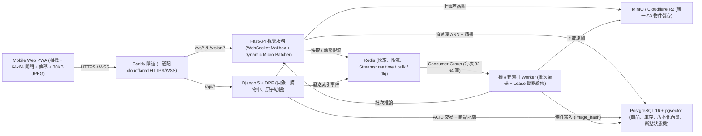

> **語言：** [English](./SYSTEM_DESIGN.md) | **繁體中文**

# 行動端即時視覺導購與高併發電商 — 系統設計書

本文件記錄將 `DeepImageSearch_with_django` 重構為 **AI Inference Infrastructure 級即時視覺導購與高併發電商平台** 的架構設計、封底估算、手機邊雲算力平衡、資料流與佇列／併發故障處理方案。

---

## 1. 對標 LLM 推論架構的 1-to-1 系統設計框架

| AI Infra 核心面向 | LLM 推論服務（如 ChatGPT） | 本專案：即時視覺搜商品推論服務 |
| :--- | :--- | :--- |
| **高階拓撲** | Client → Router → GPU Prefill/Decode → KV Store | 手機 Edge 閘門 → ASGI Gateway → **Online GPU 編碼池** → **兩階段向量檢索** → Django 商務核心 |
| **記憶體與重複計算優化** | KV Cache + GQA | 多層 Feature Cache（Edge `track_id` ＋ Redis 圖片 Hash / `search_id`）＋ **Matryoshka (MRL) 與 Binary/Halfvec 量化**（千萬向量從 ~30 GB 壓到 ~1 GB RAM） |
| **批次調度（Batching）** | Continuous Batching | **SLA-Aware Dynamic Micro-Batching**（`max_wait=15ms`, `max_batch=16`）；圖片固定解析度 `384×384` 無 padding 浪費 ＋ Deadline 過期丟棄 |
| **階段分離（Disaggregation）** | Prefill–Decode (PD) 分離 | **GPU 計算密集編碼池** vs **RAM/NVMe 記憶體密集向量檢索池** vs **IO 密集商務池**；外加 **Online 低延遲池 vs Offline 批量建索引池隔離** |
| **並行化與擴展** | Tensor Parallelism (TP) + Pipeline Parallelism (PP) | 視覺編碼器（SigLIP/OpenCLIP 僅 100M–400M 參數、FP16 `<1.5 GB`）單卡放得下 → **純 Data Parallelism (DP) ＋ Multi-Stream/MIG**（避免無謂的 TP 卡間通訊）＋ 向量庫分片並行 |

---

## 2. 封底估算（Back-of-the-Envelope：1,000 萬 SKU / 500 萬 DAU）

- **假設：** `10,000,000` 張商品圖；`5,000,000` DAU；`10%` 每日使用相機掃碼（`500,000` 人 × 每人 `10` 關鍵幀 = 每日 `500 萬` 次視覺查詢）。
- **QPS：**
  - 平均：`5,000,000 / 86,400 ≈ 58 QPS`
  - 尖峰（日夜 5× ＋ 大促 3×）：**`~900 Peak QPS`**
- **頻寬（手機端 Edge 閘門的價值）：**
  - 原圖 5 FPS 直傳（`3 MB × 5 = 15 MB/s` / 人）：4G 網路無法負荷。
  - 手機端 `64×64` 穩定/模糊閘門 ＋ `384px` JPEG（`~30 KB`）約 `1 FPS`：`900 × 30 KB ≈ 27 MB/s (~216 Mbps)` 總入口流量，單台 Gateway 即可輕鬆承載。
- **向量庫記憶體（`1,000 萬` 筆 × `768` 維）：**
  - 原始 `FP32`：`10M × 768 × 4 bytes = 30.7 GB`（含 HNSW 圖索引約 `35–40 GB RAM`）。
  - 兩階段 **Binary Quantization（`768-bit = 96 bytes`）常駐 RAM 粗排 ＋ NVMe `FP16` 精排**：
    - 粗排 RAM：`10M × 96 bytes ≈ 0.96 GB`（**節省 32 倍記憶體**）。
    - 粗排取 Top-100 後從 NVMe 讀原始 `FP16`（15.4 GB 放磁碟，隨機讀 `<2 ms`）重算精排。
- **GPU 算力與 Batching（以 NVIDIA L4 跑 SigLIP-Base FP16 為例）：**
  - `batch=1`：`~7 ms` → 單卡上限 `~140 QPS`（算力利用率僅 ~20%）。
  - Dynamic `batch=16`（`max_wait=15 ms`）：單批前向約 `~28 ms` → **`~570 QPS/卡`**（吞吐 **4 倍提升**，總延遲 `15 + 28 = 43 ms`）。
  - 扛 `900 Peak QPS` 並保留 2× 冗餘（`1,800 QPS`）：僅需 **3–4 張 L4 GPU（純 DP 水平擴充）**。

---

## 3. 手機邊雲算力平衡（Edge–Cloud Offloading）

手機瀏覽器（尤其 iOS Safari）執行重型前端 ML 容易發燙、掉電與觸發 WASM 記憶體上限，因此依照 **「算力/頻寬比」** 切分，並採用 **三層自適應分級**：

| 步驟 | 執行位置 | 設計理由 |
| :--- | :--- | :--- |
| 縮圖與 JPEG 壓縮（`384–512px`） | **手機端（永遠）** | `<3 ms`；上傳體積縮小 150 倍（`5 MB → 30 KB`），卸除伺服器解碼瓶頸。 |
| 模糊、抖動與場景變化閘門（`64×64` canvas） | **手機端（永遠）** | `<2 ms`、零模型下載；直接砍掉 **80–90%** 無效伺服器推論。 |
| 條碼 / QR 解碼 | **手機端（永遠）** | Android 原生 `BarcodeDetector` / iOS 輕量 WASM；包裝商品直接精準查 SKU（`0` GPU 消耗）。 |
| 物件偵測與框選追蹤 | **自適應（Tier 2）** | 首次造訪或舊機跳過（Tier 0/1）；PWA 回訪且具備 WebGPU 的新機才快取 ~3 MB 輕量偵測器（Tier 2）。 |
| 商品語意向量編碼（SigLIP / OpenCLIP） | **伺服器端（永遠）** | 權重 150–400 MB；放伺服器搭配 Dynamic Micro-batching 成本更低，且可無感升級模型。 |
| 向量檢索與即時庫存過濾（`pgvector`） | **伺服器端（永遠）** | 依賴全量商品目錄與即時庫存／價格。 |
| Track 快取與 UI 防閃爍（Hysteresis） | **手機端（永遠）** | 避免分數在門檻震盪造成商品卡狂閃，同物件不重複呼叫伺服器。 |

### 閉環動態降頻（Server-to-Edge Throttling）
每次 WebSocket 回應皆攜帶控制指令（`throttle: { min_interval_ms, max_dim, mode }`）：
- **低負載（<50%）：** `min_interval_ms: 500`, `mode: "auto_keyframe"`。
- **高負載（70–90%）：** `min_interval_ms: 1500–2500`, `max_dim: 320`（在手機源頭平滑削峰 3–5 倍）。
- **過載（>90%）：** 切換 `mode: "manual_tap"`（暫停自動串流，手動快門與條碼仍正常運作，徹底杜絕排隊雪崩）。

---

## 4. 端到端架構圖

---

## 5. 關鍵佇列、併發與串流故障處理

1. **即時串流與持久化 Queue 語意分離：** 即時相機串流絕不走 FIFO MQ，而是在 ASGI 層用 **Size-1 Latest-Frame-Wins Mailbox**（新幀直接覆蓋未處理舊幀、不重試、`seq_id` 防亂序）；背景索引與非同步事件則透過可抽換 `EventBroker` 介面走 **Redis Streams**（Consumer Group + `XACK` + `XAUTOCLAIM` + DLQ，未來百倍規模可無痛切換 RocketMQ/Kafka）。
2. **避免隊頭阻塞（Head-of-Line Blocking）：** 區分 `stream:index:realtime` 與 `stream:index:bulk`，搭配 Online/Offline 推論配額隔離，確保批量匯入 10,000 筆商品時即時搜尋 P99 紋風不動。
3. **批次中途失敗與斷點續傳（Checkpoint）：** 透過 DB `BatchJob` 與每圖 `index_status`（`PENDING`/`PROCESSING`/`INDEXED`/`FAILED`）＋ `lease_until` 租約機制；Worker 崩潰後僅自動接手過期未完成的一小批，不重工、不遺漏。
4. **亂序圖片覆寫防護：** S3 採用不可變 UUID Key ＋ 條件更新（`WHERE image_hash = :expected_hash`），舊任務慢完成也不會覆寫新商品圖向量。
5. **毒丸與解碼炸彈防護：** Gateway 限制檔案大小 ＋ `Image.MAX_IMAGE_PIXELS` ＋ 嚴格區分可重試錯誤（指數退避）與不可重試錯誤（立即標 `FAILED` 並送入 DLQ）。
6. **向量檢索＋SQL 過濾空結果陷阱：** 使用 `pgvector` 0.8+ HNSW Iterative Scan 確保過濾 `in_stock=True` 後仍穩定回傳足夠的候選商品。
7. **零停機模型升級：** 版本化 `ProductEmbedding(product_image_id, model_version, embedding)` 表支援背景回填新模型、Shadow/A-B 驗證後原子切流。
8. **高併發防超賣與冪等性：** 原子 SQL 扣庫存（`WHERE stock >= qty`）＋ 結帳 API 強制 `Idempotency-Key`。
9. **隱私與手機生命週期：** 查詢畫面僅於記憶體處理並清除 EXIF（預設不落盤）；監聽 `visibilitychange` 於退背景時立即停止相機軌道與暫停串流。
